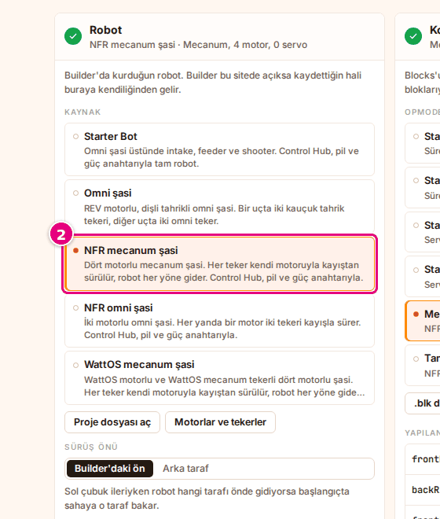
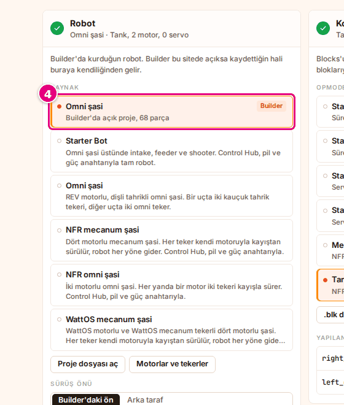
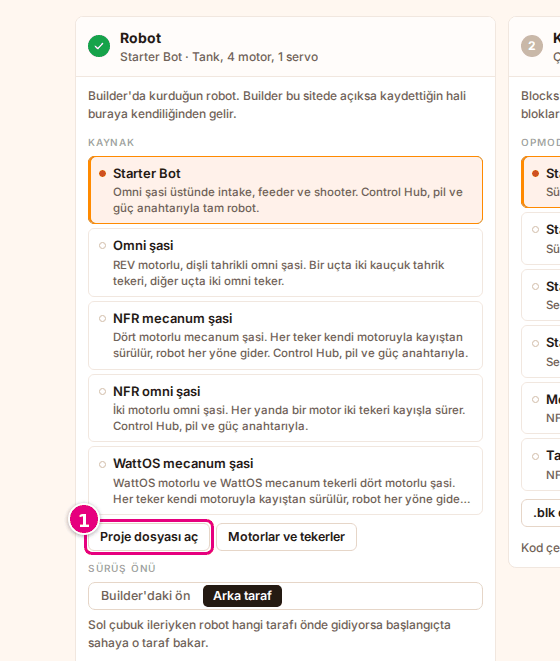
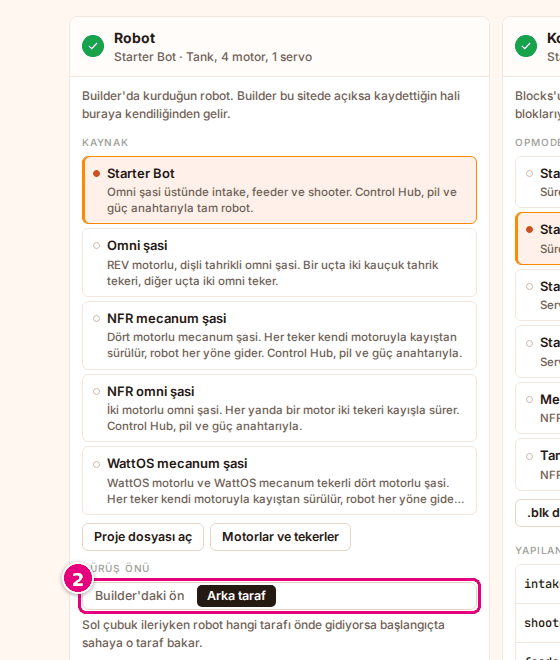

# Robotu seç

Bu sayfada Sim'de sahaya çıkacak robotu seçeceksin: hazır bir robot, Builder'da açık projen ya da
Builder'dan indirdiğin proje dosyası. Sonra robotun hangi ucunun önde gideceğini ayarlayacaksın.

Robot seçimi ana sayfadaki **Robot** bölümünde ve çalışma alanındaki **Robot** panelinde aynıdır.
Birinde seçtiğin robot ötekinde de seçili olur.

## Başlamadan önce

- Sim açık: [probotstudio.com/sim](https://probotstudio.com/sim/).
- Bilgisayar ve tarayıcı: [Ne gerekir](../index.md#ne-gerekir).
- Kendi robotunu getireceksen robot Builder'da kurulu olmalı: [Builder](../builder/index.md).

<!-- SAY: Başlamadan önce Sim'i açıyoruz, kendi robotumuz varsa onu Builder'da kurmuş oluyoruz. -->

## Hazır robot seç {#hazir-robot-sec}

Hazır robotlar Builder'ın şablonlarıdır: **Starter Bot**, **Omni şasi**, **NFR mecanum şasi**,
**NFR omni şasi**, **WattOS mecanum şasi**.

!!! tip "İpucu"
    Önce robotu, sonra programı seç. Örnek program seçiliyken bir hazır robota basarsan (seçili olana
    bile) program o robotun örneğine döner.

1. Çalışma alanındaysan araç çubuğunda **Ana sayfa**'ya bas. "Simülasyonu kur" başlıklı ana sayfada ilk
   bölüm **Robot**'tur.
2. **Robot** bölümünün **Kaynak** listesinde bir robot seç, örneğin **NFR mecanum şasi**.
   <!-- CAPTURE: url=https://probotstudio.com/sim/ | hazirla=giriş kartı ve çerez bandı kapalı | hedef=role=button[name=/^NFR mecanum şasi/] | isaret=2 | bekle=text="Kaynak" -->
   
3. **Kod** bölümünde kendi programın seçiliyse **OpMode** listesinden robotun örneğini seç, örneğin
   **Mecanum Şasi TeleOp**. Örnekler: [Örnek programı seç](programi-sec.md#ornek-programi-sec).

Sonuç: Bölüm başlığının altındaki özette robotun adı, sürüş türü, motor ve servo sayısı yazar, örneğin
"NFR mecanum şasi · Mecanum, 4 motor, 0 servo". Alt şeritteki hazırlık listesinde de "Robot: NFR mecanum
şasi (Mecanum, 4 motor, 0 servo)" yazar. **Kod** bölümündeki örnek program bu robota uygun örneğe geçer.

<!-- SAY: Hazır robotlardan birini seçince Sim ona uygun örnek programı da kendiliğinden seçiyor. -->

Kendi açtığın ya da Blocks'tan gelen bir program seçiliyse robot değişince program değişmez.

## Builder'daki açık projeyi seç

Builder ve Sim aynı tarayıcıda açıksa Sim, Builder'ın otomatik kaydettiği projeyi kendisi görür.

!!! tip "İpucu"
    Builder'ı Sim ile aynı tarayıcıda ve aynı adreste (probotstudio.com) aç. Projede en az bir parça
    olmalı; boş proje listeye gelmez.

1. Araç çubuğunda **Builder**'a bas. Builder yeni sekmede açılır.
2. Builder'da robotunu kur ya da aç. Builder projeyi kendiliğinden kaydeder.
3. Sim sekmesine dön.
4. **Kaynak** listesinde "Builder" rozetli satırı seç.
   <!-- CAPTURE: url=https://probotstudio.com/sim/ | hazirla=aynı tarayıcıda Builder'da hazır Omni şasi yüklü | hedef=.ks-oge:has-text("Builder'da açık proje") | isaret=4 | bekle=text="Builder'da açık proje" -->
   

Sonuç: Satırın açıklamasında "Builder'da açık proje, <parça sayısı> parça" yazar ve robot seçili olur.
Proje bir Builder şablonundan kurulduysa **Kod** bölümündeki örnek program da o şablonun örneğine geçer.
Kendi açtığın ya da Blocks'tan gelen bir program seçiliyse program değişmez.

Builder'da projeyi değiştirdikçe Sim listedeki robotu yeniden okur.

Builder'da **Dosya** > **Sim'de dene**'yi seçersen Sim yeni sekmede açılır ve bu satır seçili gelir.
Şablondan kurulan projede örnek program da aynı kuralla seçilir:
[Builder: Robotu Sim'de dene](../builder/simde-dene.md).

<!-- SAY: Builder aynı tarayıcıda açıksa kurduğumuz robot Sim'in listesine kendiliğinden geliyor. -->

## Builder proje dosyasını aç {#builder-proje-dosyasini-ac}

Başka bir bilgisayarda kurulan robotu Builder'ın indirdiği `.json` dosyasıyla açarsın.

!!! warning "Dikkat"
    Listede aynı anda tek bir dosya robotu durur. Yeni bir `.json` açınca ya da sayfayı yenileyince
    önceki dosya robotu listeden çıkar.

1. **Robot** bölümünde **Proje dosyası aç**'a bas (ya da **Dosya** > **Robot proje dosyası aç…**'ı seç).
   <!-- CAPTURE: url=https://probotstudio.com/sim/ | hazirla=giriş kartı ve çerez bandı kapalı | hedef=role=button[name="Proje dosyası aç"] | isaret=1 | bekle=text="Kaynak" -->
   
2. Açılan pencerede Builder'dan indirdiğin `.json` dosyasını seç.
3. **Aç**'a bas.

Sonuç: Robot "dosya" rozetiyle listeye eklenir ve seçilir. Açıklamasında "Dosyadan: <dosya adı>" yazar.

Dosya Builder projesi değilse hata çıkar. **Proje dosyası aç** ile açtıysan hata **Robot** bölümünde
kırmızı kutuda görünür. **Dosya** menüsünden açtıysan hata ekranın altında birkaç saniye görünen bir
bildirimde çıkar ("Bu dosya Builder projesi değil." ya da "Builder proje dosyası okunamadı (JSON değil).").

Bkz. [Sorun giderme](sorunlar.md#robot-dosyasi-acilmiyor).

<!-- SAY: Builder'dan indirdiğimiz proje dosyasını Sim'de açabiliyoruz. -->

## Sürüş önünü ayarla {#surus-onunu-ayarla}

Robot sahada ters gidiyorsa ya da başlangıçta yanlış yöne bakıyorsa sürüş önünü değiştir.

1. **Robot** bölümünün **Kaynak** listesinde ayarlayacağın robotu seç.
2. **Sürüş önü** seçicisinde **Builder'daki ön** ya da **Arka taraf**'ı seç.
   <!-- CAPTURE: url=https://probotstudio.com/sim/ | hazirla=Starter Bot seçili | hedef=role=radiogroup[name="Sürüş önü"] | isaret=2 | bekle=text="Sürüş önü" -->
   
3. **Kod** bölümünün **OpMode** listesinde "TeleOp" rozetli bir program seç.
4. Alt şeritte **Başlat**'a bas. Çalışma alanı açılır ve canlı sürüş başlar.
5. <kbd>W</kbd>'yi basılı tut.

Sonuç: Robot seçtiğin tarafı önde gider ve başlangıçta sahaya bu tarafla bakar. Önizlemedeki turuncu ok
başlangıç yönüdür, değişmez; değişen robotun hangi tarafının o yöne baktığıdır. Robotun önü ve arkası
**Detaylı · 3B** görünümünde daha iyi seçilir.

Starter Bot'ta **Arka taraf** seçili gelir, robot shooter önde sürülür. **Builder'daki ön**'ü seçince
robot notlarındaki "Starter Bot shooter önde sürülür; …" maddesi kalkar. Ayar her robot için ayrı saklanır.

<!-- SAY: Robot ters gidiyorsa sürüş önünü değiştirmemiz yetiyor. -->

## Robot notlarını oku

Sim robotu sahaya koyarken bazı eksikleri kendisi tamamlar. Bunları **Robot** bölümünün altında
madde madde yazar. Örnek Starter Bot notları:

- "Builder 13 eklemi kendiliğinden kurdu (projede yoktu)."
- "Shooter motoru 1:1 (6000 rpm) sayıldı; Builder şablonunda 19,2:1 görünüyor."
- "Şasi motorları 12:1 (3:1 + 4:1 kartuş) sayıldı."
- "Starter Bot shooter önde sürülür; Sim robotu başlangıçta shooter tarafı sahaya bakacak şekilde koyar."

Notlar bilgi içindir; bir şey yapman gerekmez.

<!-- SAY: Sim robotu sahaya koyarken tamamladığı eksikleri robot notlarında yazıyor. -->

## Sorun mu var?

- **"Robotta motora bağlı sürüş tekeri bulunamadı; robot yerinden kıpırdamaz." uyarısı:** Builder'da
  tekerleri motora bağla. Bkz. [Sorun giderme](sorunlar.md#robot-kipirdamiyor).
- **Builder projem listede yok:** Builder'ı aynı tarayıcıda ve aynı adreste (probotstudio.com) aç. Projeye
  en az bir parça ekle.
- **Sayfayı yenileyince dosyadan açtığım robot gitti:** Dosya robotu saklanmaz. **Proje dosyası aç** ile
  dosyayı yeniden aç.

<!-- SAY: Robot kıpırdamıyorsa tekerlerin bir motora bağlı olduğunu kontrol ediyoruz. -->

## Sonraki adım

[Programı seç](programi-sec.md)

<!-- SAY: Robotu seçtikten sonra programı seçiyoruz. -->
