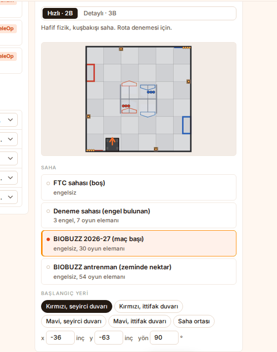
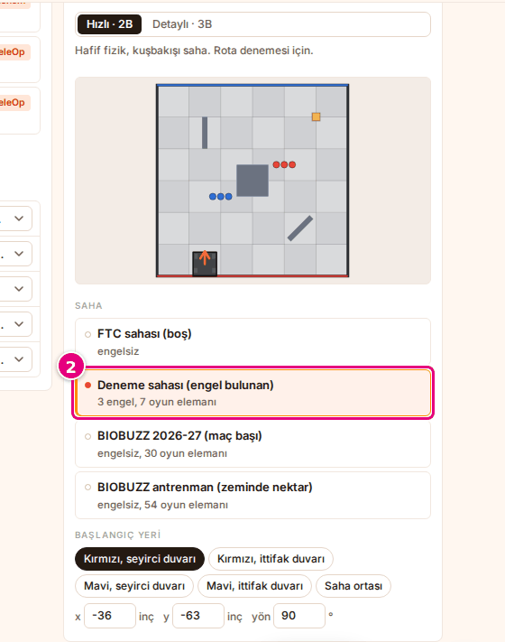
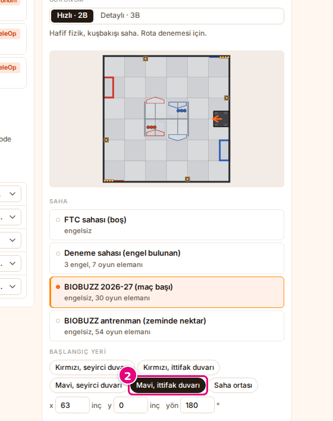
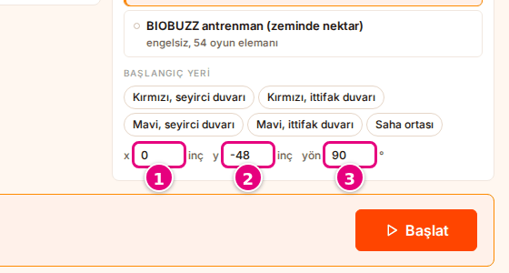
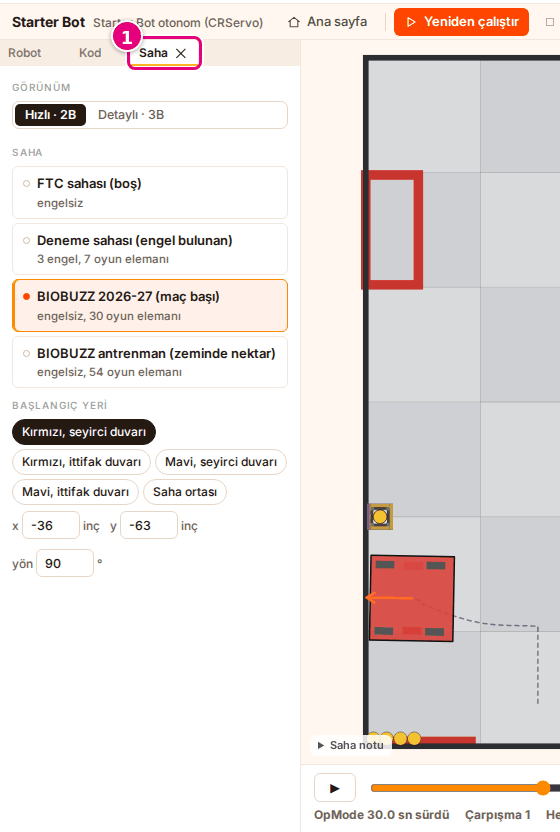
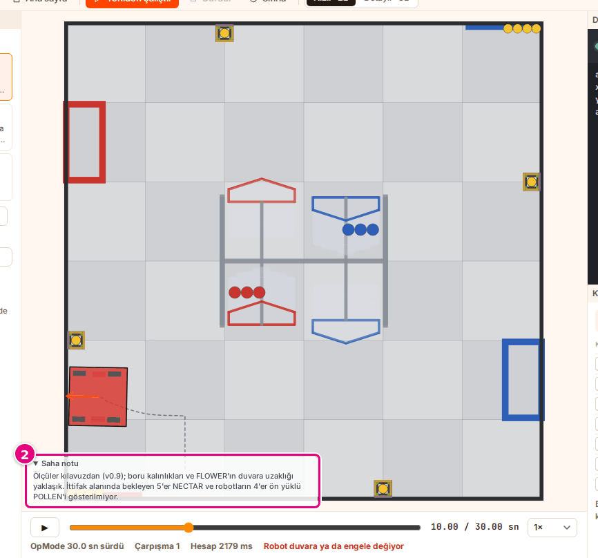

# Sahayı ve başlangıç yerini seç

Bu sayfada robotun koşacağı sahayı ve robotun sahadaki ilk yerini seçeceksin.

<!-- CAPTURE: url=https://probotstudio.com/sim/ | hazirla=Starter Bot + Starter Bot otonom (CRServo), Hızlı · 2B, BIOBUZZ 2026-27 (maç başı), Kırmızı, seyirci duvarı | hedef=role=radio[name="Hızlı · 2B"]; role=button[name=/^BIOBUZZ 2026-27/]; role=button[name="Kırmızı, seyirci duvarı"] | isaret=yok | bekle=text="Başlangıç yeri" -->
<!-- SAY: Sonunda robotumuz seçtiğimiz sahada seçtiğimiz yerde duruyor olacak. -->

Saha seçimi ana sayfadaki **Oyun** bölümünde ve çalışma alanındaki **Saha** panelinde aynıdır.

## Başlamadan önce

- Sim ana sayfası açık. Çalışma alanındaysan araç çubuğunda **Ana sayfa**'ya bas ya da
  [Çalışma alanında sahayı değiştir](#calisma-alaninda-sahayi-degistir) bölümüne geç.
- Robot ve program seçili: [Robotu seç](robotu-sec.md), [Programı seç](programi-sec.md).

<!-- SAY: Saha seçimine Sim'in ana sayfasından başlıyoruz. -->

## Sahayı seç

| Saha | İçinde ne var |
|---|---|
| **FTC sahası (boş)** | Engelsiz, oyun elemanı yok, duvarlarda AprilTag etiketleri. Rota ve sürüş denemesi için. |
| **Deneme sahası (engel bulunan)** | 3 engel, 7 oyun elemanı, duvarlarda AprilTag etiketleri. Çarpışma denemesi için. |
| **BIOBUZZ 2026-27 (maç başı)** | Maç başındaki düzen: HIVE ve FLOWER yapıları, 30 oyun elemanı. Varsayılan saha. |
| **BIOBUZZ antrenman (zeminde nektar)** | Maç başı düzeni (30 eleman) ve zemine eklenmiş 24 oyun elemanı (8 kırmızı nektar, 8 mavi nektar, 8 polen); toplam 54 oyun elemanı. |

1. Ana sayfanın **Oyun** bölümünde **Oyun türü** kartlarından **Tek başına**'yı seç.
   Saha seçimi yalnız bu oyun türünde görünür.
2. **Saha** listesinden bir saha seç, örneğin **Deneme sahası (engel bulunan)**.
   Her satırın altında engel ve oyun elemanı sayısı yazar.
   <!-- CAPTURE: url=https://probotstudio.com/sim/ | hazirla=Starter Bot + Starter Bot otonom (CRServo) | hedef=role=button[name=/^Deneme sahası/] | isaret=2 | bekle=text="Başlangıç yeri" -->
   
3. **Görünüm**'de **Hızlı · 2B**'yi ya da **Detaylı · 3B**'yi seç.

Sonuç: Başlangıç önizlemesinde seçtiğin saha çizilir. Alt şeritteki hazırlık listesinde
"Saha: <saha adı>, hızlı 2B görünüm" yazar (**Detaylı · 3B** seçiliyse "detaylı 3B görünüm").

**Detaylı · 3B** görünümde robot oyun elemanlarını itebilir. BIOBUZZ'daki HIVE'ın üst hücresine yeterince
eleman girip orada kısa bir süre kalınca HIVE kendiliğinden devrilir. Robot HIVE'ı iterek deviremez.

**Hızlı · 2B** görünümde HIVE ve FLOWER yapıları sabittir. Yalnız zeminde başlayan elemanlar itilir;
HIVE hücrelerindeki ve FLOWER üstündeki elemanlar yerinde durur. Sahaya eleman ekleyip silemezsin.

**FTC sahası (boş)** ve **Deneme sahası (engel bulunan)** duvarlarında AprilTag etiketleri durur. 2B sahnede
duvar dibinde ince siyah şerit, 3B sahnede duvara dayalı levha olarak çizilir. Java programındaki kamera ve
Limelight bu etiketleri görür: [Java'da ne çalışır](programi-sec.md#java-calisanlar).

Görünümler arasındaki fark: [Görünümü değiştir](gorunumu-degistir.md).

<!-- SAY: Boş saha, engelli deneme sahası ve BIOBUZZ sahaları arasından seçim yapıyoruz. -->

## Hazır başlangıç yeri seç

| Başlangıç yeri | x | y | yön |
|---|---|---|---|
| **Kırmızı, seyirci duvarı** | -36 inç | -63 inç | 90° |
| **Kırmızı, ittifak duvarı** | -63 inç | 0 | 0° |
| **Mavi, seyirci duvarı** | 36 inç | -63 inç | 90° |
| **Mavi, ittifak duvarı** | 63 inç | 0 | 180° |
| **Saha ortası** | 0 | 0 | 0° |

!!! note "Not"
    Çalışma alanında daha önce program koştuysan önizleme o koşunun son karesini göstermeye devam eder ve robot
    yerinden kıpırdamaz. Yeni yeri görmek için sayfayı yenile ya da **Ana sayfa**'ya dönmeden önce çalışma alanında
    **Sıfırla**'ya bas. **Başlat**'a basarsan robot çalışma alanında yeni yerinden başlar.

1. **Oyun** bölümünde **Saha** listesinden **BIOBUZZ 2026-27 (maç başı)**'nı seç.
2. **Başlangıç yeri** satırında bir düğme seç, örneğin **Mavi, ittifak duvarı**.
   Düğme koyu renge döner. **x**, **y** ve **yön** kutuları düğmenin değerlerini gösterir.
   <!-- CAPTURE: url=https://probotstudio.com/sim/ | hazirla=Starter Bot, BIOBUZZ 2026-27 (maç başı) | hedef=role=button[name="Mavi, ittifak duvarı"] | isaret=2 | bekle=text="Başlangıç yeri" -->
   
3. Alt şeritte **Başlat**'a bas.

Sonuç: Çalışma alanı açılır. Robot sahada seçtiğin başlangıç yerinden, tablodaki yöne bakarak başlar.

<!-- SAY: Hazır başlangıç yerlerinden birini seçince robot sahada o noktaya geçiyor. -->

## Başlangıç yerini elle gir

Sahanın ortası (0, 0) noktasıdır. Saha 144 × 144 inçtir; kenarlar -72 ile 72 arasındadır.

- **x** BIOBUZZ sahalarında eksi yönde kırmızı ittifak tarafına, artı yönde mavi ittifak tarafına gider.
  FTC sahası (boş) ve Deneme sahasında ise 2B görünüm kırmızı çizgiyi alt kenara (y eksi), mavi çizgiyi
  üst kenara (y artı) çizer.
- Hazır başlangıç yerlerinin adları bütün sahalarda x yönüne göre verilir (kırmızı x eksi, mavi x artı).
- **y** eksi yönde seyirci duvarına gider.
- **yön** 0° iken robot x artı yönüne bakar; bu yön BIOBUZZ'da mavi taraftır. 90° iken robot seyirci
  duvarının tersine bakar.

!!! tip "İpucu"
    2B sahnede fareyi sahanın üstünde gezdirince köşede imlecin yeri "x … · y … inç" olarak yazar.
    Bu değeri kutulara yazabilirsin.

1. **x** kutusuna inç cinsinden bir sayı yaz, örneğin `0`.
2. **y** kutusuna bir sayı yaz, örneğin `-48`.
3. **yön** kutusuna derece yaz ya da kutunun oklarıyla 15'er derece değiştir.
   <!-- CAPTURE: url=https://probotstudio.com/sim/ | hazirla=Starter Bot, x 0, y -48, yön 90 | hedef=label:has-text("x") >> input; label:has-text("y") >> input; label:has-text("yön") >> input | isaret=1,2,3 | bekle=text="Başlangıç yeri" -->
   

Sonuç: Robot önizlemede yeni yerine geçer. Değer hazır bir yere uymuyorsa hiçbir düğme koyu olmaz.
Çalışma alanında daha önce program koştuysan önizleme son koşunun karesinde kalır (bkz. "Hazır başlangıç yeri seç" bölümündeki not).

<!-- SAY: Başlangıç yerini inç cinsinden x ve y değerleriyle elle de verebiliyoruz. -->

## Çalışma alanında sahayı değiştir {#calisma-alaninda-sahayi-degistir}

**Saha** paneli ana sayfadaki **Oyun** bölümünün aynı seçimlerini taşır. Panelin başında **Görünüm** seçici de vardır.

!!! note "Not"
    TeleOp sürerken sahayı ya da başlangıç yerini değiştirirsen sürüş durur ve sıfırlanır. Yeniden sürmek
    için araç çubuğunda **Başlat**'a bas.

1. Çalışma alanında sol panellerdeki **Saha** sekmesini seç.
   <!-- CAPTURE: url=https://probotstudio.com/sim/#calis | hazirla=Starter Bot + Starter Bot otonom (CRServo), BIOBUZZ 2026-27 (maç başı), otonom bitmiş, Saha sekmesi seçili | hedef=.dv-tab:has-text("Saha") | isaret=1 | bekle=text="Başlangıç yeri" -->
   
2. **Saha** listesinden bir saha seç.
3. **Başlangıç yeri** satırında bir düğme seç ya da **x**, **y**, **yön** kutularına değer yaz.

Sonuç: Otonom program yeni sahada ve yeni yerden kendiliğinden yeniden koşar. Ana sayfadaki **Oyun**
bölümünde de aynı saha ve başlangıç yeri seçili olur.

<!-- SAY: Çalışma alanında sahayı değiştirince otonom kendiliğinden yeniden koşuyor. -->

## Saha notunu oku

BIOBUZZ sahalarında sahnenin köşesinde **Saha notu** kutusu durur. Öteki sahalarda bu kutu yoktur.

1. Çalışma alanında **Saha** panelinin **Saha** listesinden bir BIOBUZZ sahası seç, örneğin
   **BIOBUZZ 2026-27 (maç başı)**.
2. Sahnenin köşesindeki **Saha notu**'na bas.
   Kutu açılır ve notu gösterir.
   <!-- CAPTURE: url=https://probotstudio.com/sim/#calis | hazirla=BIOBUZZ 2026-27 (maç başı), Hızlı · 2B, Saha notu açık | hedef=summary:has-text("Saha notu") | isaret=2 | bekle=text="Saha notu" -->
   
3. Kapatmak için **Saha notu**'na yeniden bas.

Sonuç: Kutu kapanır.

**BIOBUZZ 2026-27 (maç başı)** sahasında not şunu yazar: "Ölçüler kılavuzdan (v0.9); boru kalınlıkları ve
FLOWER'ın duvara uzaklığı yaklaşık. İttifak alanında bekleyen 5'er NECTAR ve robotların 4'er ön yüklü POLLEN'i gösterilmiyor."

**BIOBUZZ antrenman (zeminde nektar)** sahasında notun başında "Antrenman düzeni (resmi maç başı değil)." yazar.

<!-- SAY: Saha notu BIOBUZZ sahasının hangi ölçülerinin yaklaşık olduğunu söylüyor. -->

## Sonraki adım

[Otonomu çalıştır ve kaydı incele](otonomu-calistir.md)

<!-- SAY: Saha hazır olunca otonomu çalıştırıyoruz. -->
