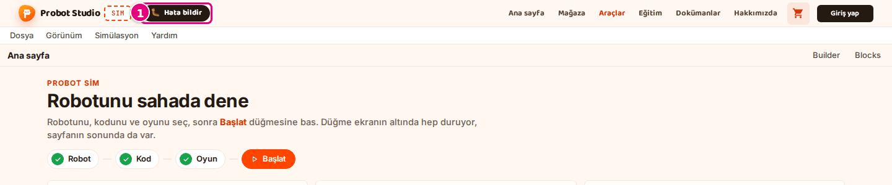
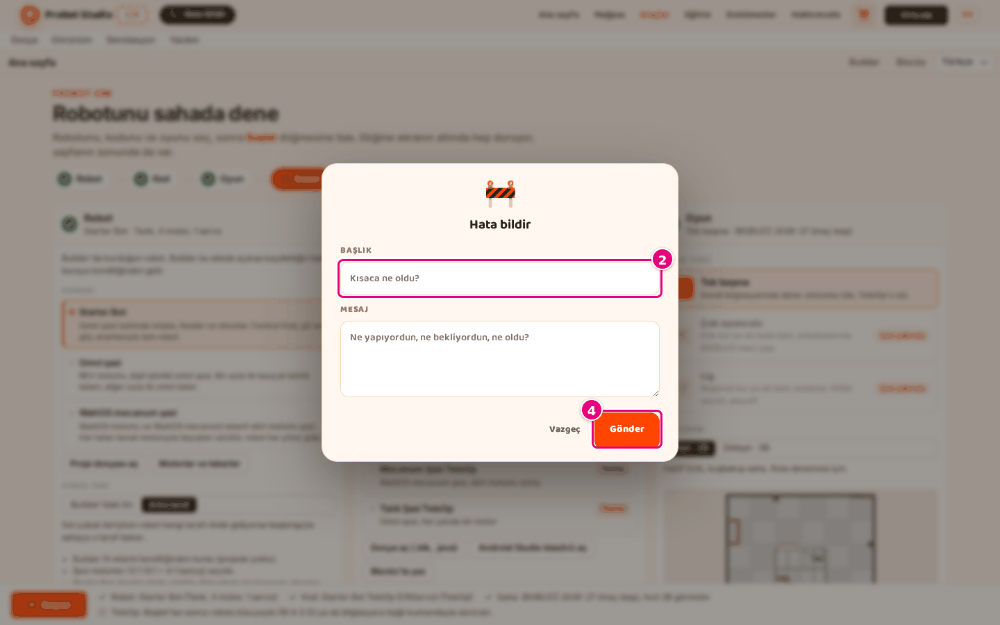

# Sorun giderme

Sim'de en sık karşılaşılan sorunlar. Önce durum göstergelerine bak, sonra belirtinin başlığını bul.
Ekranda bir yazı çıktıysa başlıklar o yazıyla başlar; altında sebep ve çözüm yazar.

## Önce durum göstergelerine bak {#durum-gostergeleri}

Çalışma alanında araç çubuğundaki durum rozeti koşunun durumunu gösterir. Ana sayfada her bölümün
numaralı dairesi ve alt şeritteki hazırlık listesi seçimlerinde eksik olup olmadığını gösterir.

| Gösterge | Anlamı | Ne yap |
|---|---|---|
| Durum rozeti "Hazır" | Koşu başlamadı. | Araç çubuğunda **Çalıştır**'a ya da **Başlat**'a bas. |
| Durum rozeti "Hesaplanıyor" | Otonom hesaplanıyor. | Hesap bitene kadar bekle. 60 saniyede bitmezse rozet "Hata" olur: [Program hata verdi](#program-hatasi). |
| Durum rozeti "Bitti" | Koşu bitti, kayıt izlenebilir. Program hata verse de rozet "Bitti" olur. | **Driver Station**'da kırmızı yazı varsa [Program hata verdi](#program-hatasi) bölümünde ara. |
| Durum rozeti "Canlı · klavye" | TeleOp klavyeyle sürülüyor. | Tuşlar robota gitmiyorsa sahneye bir kez tıkla: [Robot kıpırdamıyor](#robot-kipirdamiyor). |
| Durum rozeti "Canlı · kumanda" | TeleOp bilgisayara bağlı kumandayla sürülüyor. | Düğme eşlemesi: [Kısayollar](kisayollar.md#kumanda). |
| Durum rozeti "Hata" | Program süresinde bitmedi ya da simülasyon açılamadı. | **Driver Station**'daki kırmızı yazıyı [Program hata verdi](#program-hatasi) bölümünde ara. |
| Bölüm dairesi sarı | O bölümde bir uyarı var. | Hazırlık listesindeki sarı maddeye bas. Sayfa ilgili bölüme kayar. |
| Bölüm dairesi kırmızı | Robot ya da kod okunamadı. | [Kod çevrilemedi](#kod-cevrilemedi) ya da [Dosya açılmıyor](#robot-dosyasi-acilmiyor) bölümüne bak. |
| Bölüm dairesi gri | Kod çevriliyor. **Başlat** pasif. | Kod çevrilene kadar bekle: [Başlat ya da Çalıştır basılmıyor](#baslat-basilmiyor). |
| Bölüm dairesi yeşil onay | O bölümde eksik yok. | Üç daire de yeşilse **Başlat**'a bas. |

<!-- SAY: Bir sorun olduğunda önce durum rozetine ve hazırlık listesine bakıyoruz. -->

## Robot kıpırdamıyor {#robot-kipirdamiyor}

| Sebep | Çözüm |
|---|---|
| Programdaki bir cihaz adı robotta bir porta bağlı değil. Hazırlık listesinde "Robotta karşılığı bulunmayan cihaz: …" yazar. | [Cihazları porta bağla](cihazlari-porta-bagla.md). |
| Programdaki motor adı robotta bir porta bağlı değil. Driver Station'da ""<ad>" motoru robotta yok; boşta dönen sanal motor olarak çalışıyor." yazar. TeleOp'ta bu uyarı sürüş sırasında görünmez; **Durdur**'a basınca ya da 120 saniye dolunca çıkar. | [Cihazları porta bağla](cihazlari-porta-bagla.md). |
| Servo kıpırdamıyor: programdaki servo adı robotta bir porta bağlı değil. Driver Station'da ""<ad>" servosu robotta yok; komutları yok sayılıyor." yazar. Bu uyarı da çalıştırma bitince görünür. | [Cihazları porta bağla](cihazlari-porta-bagla.md). |
| Robotta motora bağlı sürüş tekeri yok. Hazırlık listesinde "Robotta motora bağlı sürüş tekeri bulunamadı; robot yerinden kıpırdamaz." yazar. | Builder'da tekerleri bir motora bağla ya da hazır bir robot seç: [Robotu seç](robotu-sec.md). |
| TeleOp seçili ama sürüş başlamadı. Rozet "Hazır" ya da "Bitti". | Araç çubuğunda **Başlat**'a bas: [TeleOp'u sür](teleopu-sur.md). |
| Odak bir sayı kutusunda ya da listede. Tuşlar robota gitmez. | Sahneye bir kez tıkla, sonra tuşa bas. |
| Türkçe F klavye kullanıyorsun. | Sim tuşların yerine bakar: [Kısayollar](kisayollar.md#surus-tuslari). |
| Program sensör bekliyor (örneğin dokunma sensörüne basılmasını). Sim sensör canlandırmaz. | Programı sensörsüz bir sürümle dene. |

<!-- SAY: Robot kıpırdamıyorsa önce hazırlık listesine ve Driver Station uyarılarına bakıyoruz. -->

## Program hata verdi {#program-hatasi}

**Driver Station** panelinde kırmızı yazı çıkar. Durum rozeti yalnız program süresinde bitmezse ya da simülasyon açılamazsa "Hata" olur.
Diğer hatalarda rozet "Bitti" gösterir; hatayı Driver Station'daki kırmızı yazıdan okursun.

!!! note "Not"
    Driver Station'daki sarı uyarılar programı durdurmaz. "<nesne>.<metot> sim'de yok sayılıyor" yazarsa Sim o komutu (örneğin kumanda titreşimi) atlar ve program sürer.

<!-- SAY: Program hata verirse nedenini Driver Station'daki kırmızı yazıdan okuyoruz. -->

### "Sim bu bloğu henüz çalıştırmıyor: …" {#blok-calismiyor}

Sebep: Program Sim'in desteklemediği bir blok kullanıyor. Yazının sonunda bloğun adı yazar.

Çözüm: O bloğu çıkar ya da programı gerçek robotta dene.

Bkz. [Programın hangi blokları çalışır](programi-sec.md#calisan-bloklar).

### "Sim Java çağıran özel blokları (myBlocks) henüz çalıştırmıyor" {#myblocks}

Sebep: Programda myBlocks var.

Çözüm: myBlocks bloklarını çıkar.

Bkz. [Programın hangi blokları çalışır](programi-sec.md#calisan-bloklar).

### "Program zaman ilerletmeden dönüyor: …" {#zaman-ilerlemiyor}

Tam yazı: "Program zaman ilerletmeden dönüyor: döngüye opModeIsActive ya da sleep koy."

Sebep: Döngüde ne **opModeIsActive** koşulu ne **sleep** bloğu var. Sim'de zaman ilerlemiyor.

Çözüm: Döngü koşuluna **opModeIsActive** ekle ya da döngünün içine bir **sleep** bloğu koy.

### "Program 60 saniyede bitmedi; durduruldu." {#sure-asildi}

TeleOp'ta yazı "Program 150 saniyede bitmedi; durduruldu." olur. Rozet "Hata" olur.

Sebep: Hesap süre sınırını aştı: Otonom için 60, TeleOp için 150 saniye.

Çözüm: Döngüde **opModeIsActive** koşulu olduğunu kontrol et. **Hızlı · 2B**'de dene.

Bkz. [Görünümü değiştir](gorunumu-degistir.md).

### "Program hatası: …" {#program-hatasi-mesaj}

Yazı bazen yalnız "Program hatası" olur.

Sebep: Program çalışırken beklenmeyen bir hata oluştu. İki noktadan sonraki mesaj hatanın ne olduğunu söyler.

Çözüm: Mesajın işaret ettiği bloğu Blocks'ta düzelt. Sorun sürerse [hata bildir](#hata-bildir).

### "Simülasyon işçisi açılamadı" {#isci-acilamadi}

Sebep: Tarayıcı simülasyonu başlatamadı. Rozet "Hata" olur.

Çözüm: Sayfayı yenile. Olmazsa Chrome, Edge ya da Firefox'un güncel sürümünü kullan.

## Başlat ya da Çalıştır basılmıyor {#baslat-basilmiyor}

Düğme gri görünür ve basınca bir şey olmaz.

| Sebep | Çözüm |
|---|---|
| Hazırlık listesinde **Kod** satırında "Kod çevriliyor…" yazıyor. Ana sayfadaki **Başlat** ve araç çubuğundaki **Çalıştır** kod çevrilene kadar pasiftir. | Kod çevrilene kadar bekle. Satır "Kod: <ad> (…)" olunca düğme basılır. |
| Hazırlık listesinde "Kod çevrilemedi: …" yazıyor. | [Kod çevrilemedi](#kod-cevrilemedi) bölümüne bak. |
| Araç çubuğunda "Hesaplanıyor…" yazıyor. Otonom hesabı sürüyor. | Hesabın bitmesini bekle. Durum rozeti "Bitti" olunca **Yeniden çalıştır**'a basabilirsin. |

<!-- SAY: Başlat gri ise önce hazırlık listesindeki Kod satırına bakıyoruz. -->

## Kod çevrilemedi {#kod-cevrilemedi}

Hazırlık listesinde "Kod çevrilemedi: …" yazar, **Kod** bölümünün özeti "Kod çevrilemedi" olur.

<!-- SAY: Kod çevrilemezse hazırlık listesi nedenini yazıyor. -->

### "Kod çevrilemedi: Programda runOpMode bloğu yok" {#runopmode-yok}

Sebep: Programda **runOpMode** bloğu yok.

Çözüm: Blocks'ta programı bir FTC örneğinden başlat.

Bkz. [Yeni FTC programı yaz](../blocks/ftc-program-yaz.md).

### "Kod çevrilemedi: Bu bir FTC Blocks (.blk) dosyası değil" {#blk-degil-kod}

Sebep: Dosyanın içi FTC Blocks değil.

Çözüm: Blocks'un **FTC Blocks** modundan indirdiğin `.blk` dosyasını aç.

Bkz. [.blk dosyasını aç](programi-sec.md#blk-dosyasini-ac).

### "Kod çevrilemedi: FTC Blocks dosyası yüklenemedi: …" {#blocks-yuklenemedi}

Sebep: Bağlantı koptu.

Çözüm: Sayfayı yenile.

## Dosya açılmıyor {#robot-dosyasi-acilmiyor}

Bölümdeki **Proje dosyası aç** ya da **.blk dosyası aç** düğmesiyle açtıysan hata o bölümde kırmızı kutuda yazar.
**Dosya** menüsünden açtıysan ekranın altında birkaç saniyelik bir bildirim çıkar; dosya açıldıysa "<dosya adı> açıldı" yazar.

<!-- SAY: Dosya açılmazsa kırmızı kutu ya da alttaki bildirim nedenini söylüyor. -->

### "Bu dosya Builder projesi değil." {#builder-projesi-degil}

Sebep: `.json` dosyası Builder'dan değil.

Çözüm: Builder'da **Dosya** menüsünden projeyi kaydet, o dosyayı aç.

Bkz. [Builder proje dosyasını aç](robotu-sec.md#builder-proje-dosyasini-ac).

### "Builder proje dosyası okunamadı (JSON değil)." {#json-degil}

Sebep: Dosya bozuk ya da `.json` değil.

Çözüm: Dosyayı Builder'dan yeniden kaydet.

### "Bu dosya FTC Blocks (.blk) değil." {#blk-degil}

Sebep: `.blk` dosyasının içi FTC Blocks değil.

Çözüm: Blocks'un **FTC Blocks** modundan indirdiğin dosyayı aç.

Bkz. [.blk dosyasını aç](programi-sec.md#blk-dosyasini-ac).

!!! info "Yakında"
    Bu özellik şu an geliştirme sürümünde; yakında probotstudio.com'a gelecek.
    Yazı "Bu dosya FTC Blocks (.blk) ya da Java (.java) değil." olur; aynı düğmeyle `.java` dosyası da açılır.

### "Robot okunamadı: …" {#robot-okunamadi}

Hazırlık listesinde "Robot okunamadı (…); yerine Starter Bot kullanılıyor." yazar.

Sebep: Seçili robot çizilemedi.

Çözüm: Başka bir robot seç ya da dosyayı Builder'dan yeniden kaydet.

Bkz. [Robotu seç](robotu-sec.md).

## Java projesi açılmıyor {#java-acilmiyor}

!!! info "Yakında"
    Bu özellik şu an geliştirme sürümünde; yakında probotstudio.com'a gelecek.

Android Studio projesini açarken çıkan hatalar **Kod** bölümünde kırmızı kutuda ya da ekranın altındaki
bildirimde yazar. Çevrilemeyen Java dosyaları **Kod** bölümünde "<dosya>, satır <sayı>: <mesaj>" diye
listelenir. Projeyi açma: [Android Studio projesini aç](programi-sec.md#android-studio-projesini-ac).

<!-- SAY: Java projesi açılmazsa Kod bölümündeki kırmızı kutu nedenini satır numarasıyla söylüyor. -->

| Ekrandaki yazı | Sebep | Çözüm |
|---|---|---|
| "Seçilen yerde .java dosyası yok. Android Studio projesinde TeamCode klasörünü seç." | Seçtiğin klasörde `.java` dosyası yok. | `TeamCode` klasörünü seç. |
| "OpMode bulunamadı: @TeleOp ya da @Autonomous ile işaretli sınıf yok." | Dosyalarda OpMode sınıfı yok. | OpMode sınıfına `@TeleOp` ya da `@Autonomous` ekle, Android Studio'da kaydet, klasörü yeniden aç. |
| "OpMode bulunamadı; <dosya> okunamadı (satır <sayı>): …" | Dosyada Sim'in okuyamadığı bir satır var. | Yazıdaki satırı düzelt ya da o dosyayı seçmeden aç. |
| "Proje çok büyük; yalnız TeamCode klasörünü seç." | Bütün proje klasörü seçildi. | Yalnız `TeamCode` klasörünü seç. |
| "Proje açıldı ama tarayıcıya kaydedilemedi (yer yok); sayfayı yenileyince yeniden seç." | Tarayıcının bu siteye ayırdığı yer doldu. | Sayfayı yeniledikten sonra klasörü yeniden aç. |
| "Klasör okunamadı: …" | Tarayıcı klasörü okuyamadı ya da izin verilmedi. | Klasörü yeniden aç, tarayıcı sorarsa izin ver. |

Program çalışırken çıkan Java hataları **Driver Station**'da kırmızı yazar:

| Ekrandaki yazı | Sebep | Çözüm |
|---|---|---|
| "Sim bu Java sınıfını henüz çalıştırmıyor: …" | Kod Sim'in tanımadığı bir sınıfı kullanıyor. | O kısmı OpMode'dan çıkar ya da robotta dene. [Hata bildir](#hata-bildir). |
| ""<ad>" (<tür>) bulunamadı. Sim cihaz adlarını koddan okur: …" | Cihaz adı koddan okunamadı ya da robotta karşılığı yok. | Adı `hardwareMap.get(DcMotor.class, "left_drive")` gibi metin olarak yaz, sonra [cihazları porta bağla](cihazlari-porta-bagla.md). |
| "Sim aynı anda çalışan Thread'leri desteklemiyor; işi OpMode döngüsüne taşı." | Kod ayrı bir `Thread` başlatıyor. | İşi OpMode döngüsüne taşı. |

## "Canlı sürüş bu tarayıcı penceresinde açılamadı" yazıyor {#canli-surus-acilmadi}

**Başlat**'a basınca "Canlı sürüş bu tarayıcı penceresinde açılamadı (sayfa izolasyonu yok). Sayfayı yenileyip tekrar dene." yazar.

| Sebep | Çözüm |
|---|---|
| Sayfa başka bir sitenin içinde ya da eski bir sekmede açık. | Sayfayı yenile. Olmazsa [probotstudio.com/sim](https://probotstudio.com/sim/) adresini yeni sekmede aç. |
| Tarayıcı eski. | Chrome, Edge ya da Firefox'un güncel sürümünü kullan. |

<!-- SAY: Canlı sürüş açılmazsa sayfayı yeniliyoruz. -->

## 3B sahne yavaş {#3b-yavas}

| Sebep | Çözüm |
|---|---|
| **Detaylı · 3B** sağlam fizik kullanır ve ekran kartını yorar. | **Görünüm**'de **Hızlı · 2B**'yi seç: [Görünümü değiştir](gorunumu-degistir.md). |
| Sahada çok oyun elemanı var. | **FTC sahası (boş)** ya da **BIOBUZZ 2026-27 (maç başı)** sahasını seç. |

<!-- SAY: 3B sahne yavaşsa hızlı 2B görünüme geçiyoruz. -->

## Seçimlerim kayboldu {#secimler-kayboldu}

| Sebep | Çözüm |
|---|---|
| Sim seçimleri yalnız bu tarayıcıda saklar. Tarayıcı verisi silindi, gizli pencere ya da başka bilgisayar kullanılıyor. | Robotu ve programı yeniden seç. Kalıcı kopya için robotu Builder'da, programı Blocks'ta dosya olarak kaydet. |
| Paneller dağıldı. | **Görünüm** > **Pencere düzenini sıfırla**: [Düzeni sıfırla](panelleri-duzenle.md#duzeni-sifirla). |

<!-- SAY: Seçimler yalnız bu tarayıcıda saklandığı için robotu ve programı dosya olarak da kaydediyoruz. -->

## Hata bildir {#hata-bildir}

Belgede çözümü olmayan bir sorunu ekibe buradan bildirirsin.

!!! info "Yakında"
    Bu özellik şu an geliştirme sürümünde; yakında probotstudio.com'a gelecek.
    İlk adımdaki **Hata bildir** ekranın köşesinde değil, site başlığında "SIM" rozetinin yanında durur. Pencere 560 pikselden darsa yalnız 🐛 simgesi görünür.

<!-- CAPTURE: url=https://probotstudio.com/sim/ | hazirla=giriş kartı ve çerez bandı kapalı | hedef=probot-header >> .hatabtn | isaret=1 | bekle=text="Hata bildir" | surum=dev -->

1. Ekranın köşesindeki **Hata bildir**'e bas.
   <!-- CAPTURE: url=https://probotstudio.com/sim/ | hazirla=giriş kartı ve çerez bandı kapalı, Hata bildir formu açık | hedef=placeholder="Kısaca ne oldu?"; text="Gönder" | isaret=2,4 | bekle=text="Başlık" -->
   
2. **Başlık**'a sorunu kısaca yaz.
3. **Mesaj**'a şunları yaz:
    - Açık robot ve program, ör. "Starter Bot + Starter Bot TeleOp (CRServo)".
    - Son bastığın düğme ya da tuş.
    - Ekrandaki yazı, tırnak içinde birebir.
    - Tarayıcın, ör. Chrome.
4. **Gönder**'e bas.

Sonuç: Formda "Alındı, teşekkürler! 🎉" yazar.

Göndermekten vazgeçersen **Vazgeç**'e bas. Başlık en çok 120, mesaj en çok 4000 karakterdir; ikisi de
boş bırakılamaz. "Gönderilemedi" yazarsa bir süre sonra yeniden dene ya da iletişim sayfasından yaz.

<!-- SAY: Hata bildir formuyla sorunu başlık ve mesaj yazarak ekibe gönderiyoruz. -->
