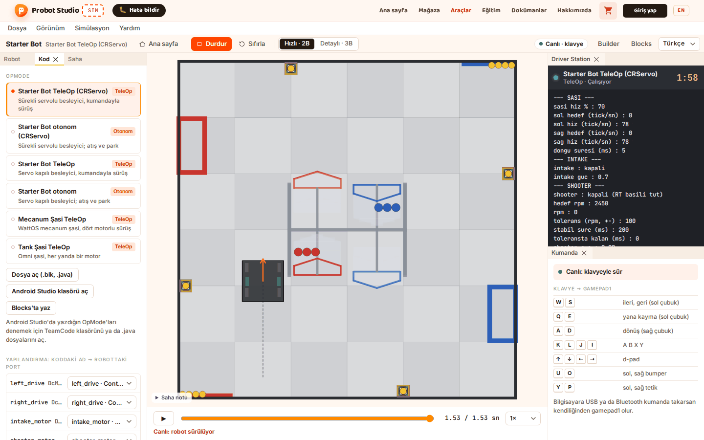
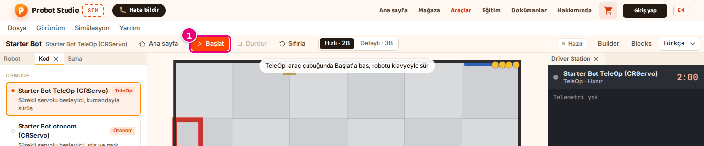
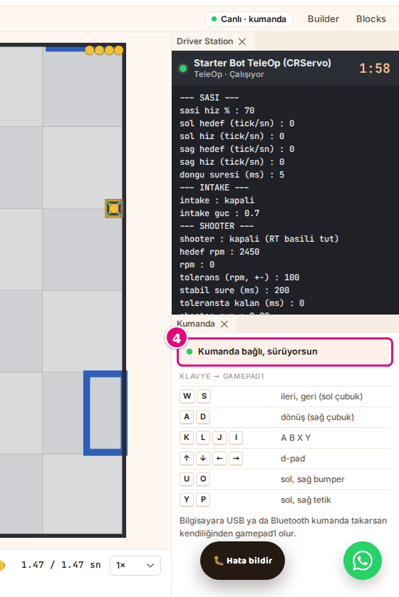
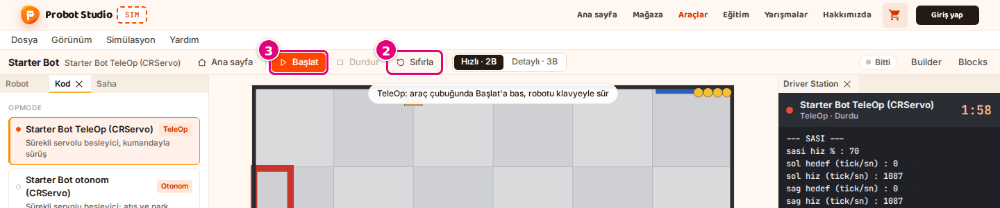

# TeleOp'u klavyeyle ya da kumandayla sür

Bu sayfada TeleOp programını başlatacak, robotu klavyeyle ya da bilgisayara bağlı kumandayla süreceksin.

<!-- CAPTURE: url=https://probotstudio.com/sim/#calis | hazirla=Starter Bot + Starter Bot TeleOp (CRServo), Başlat'a basılmış, W ile biraz ileri sürülmüş | hedef=body | isaret=yok | bekle=text="Canlı · klavye" -->
<!-- SAY: Sonunda robotu sahada klavyeyle ya da kumandayla sürüyoruz. -->

TeleOp 120 saniye koşar ve yalnız sen **Başlat**'a basınca başlar. Klavye ve kumanda programa
**gamepad1** olarak gider. İkinci kumanda (**gamepad2**) yoktur.

## Başlamadan önce

- **Kod** bölümünde "TeleOp" rozetli bir program seçili. Hazır örnek: **Starter Bot** robotu ile
  **Starter Bot TeleOp (CRServo)** programı.
- Çalışma alanı açık. Sahnenin üstünde "TeleOp: araç çubuğunda Başlat'a bas, robotu klavyeyle sür" yazar.

Ana sayfada alt şeritteki **Başlat**'a basarsan çalışma alanı açılır ve sürüş doğrudan başlar. O zaman
aşağıda 1. adımı atla.

<!-- SAY: Önce TeleOp rozetli bir program seçiyoruz. -->

## Klavyeyle sür

!!! tip "İpucu"
    Bir sayı kutusuna ya da listeye yazarken tuşlar robota gitmez. Robot kıpırdamıyorsa sahneye bir kez tıkla, sonra tuşa bas.

1. Araç çubuğunda **Başlat**'a bas.
   <!-- CAPTURE: url=https://probotstudio.com/sim/#calis | hazirla=Starter Bot + Starter Bot TeleOp (CRServo), çalışma alanı | hedef=role=toolbar[name="Araçlar"] >> role=button[name="Başlat"] | isaret=1 | bekle=text="TeleOp hazır: Başlat'a bas" -->
   
2. Robotu ileri götürmek için <kbd>W</kbd>'yi, geri götürmek için <kbd>S</kbd>'yi basılı tut.
3. Döndürmek için <kbd>A</kbd> ya da <kbd>D</kbd>'ye basılı tut.
4. Bitirmek için araç çubuğunda **Durdur**'a bas.

Sonuç: Sürüş boyunca durum rozetinde "Canlı · klavye", **Kumanda** panelinde "Canlı: klavyeyle sür",
zaman çizelgesinde "Canlı: robot sürülüyor" yazar. **Durdur**'dan sonra rozet "Bitti" olur.

Başka pencereye geçince basılı tuşlar bırakılır.

<!-- SAY: Başlat'a basıyoruz ve robotu W A S D tuşlarıyla sahada sürüyoruz. -->

## Tuşları öğren

**Kumanda** panelindeki tabloda tuşlar yazar. Panel kapalıysa **Yardım** > **Kumanda tuşları**'nı seç.
Dar ekranda bu komut bir şey yapmaz; sahnenin altındaki **Kumanda** sekmesine bas.

| Tuş | gamepad1'de |
|---|---|
| <kbd>W</kbd> / <kbd>S</kbd> | **Sol çubuk** ileri / geri |
| <kbd>A</kbd> / <kbd>D</kbd> | **Sağ çubuk** sol / sağ (dönüş) |
| <kbd>Q</kbd> / <kbd>E</kbd> | **Sol çubuk** sol / sağ (yana kayma) |
| <kbd>K</kbd> <kbd>L</kbd> <kbd>J</kbd> <kbd>I</kbd> | **A**, **B**, **X**, **Y** düğmeleri |
| <kbd>↑</kbd> <kbd>↓</kbd> <kbd>←</kbd> <kbd>→</kbd> | **D-pad** |
| <kbd>U</kbd> / <kbd>O</kbd> | **Sol bumper** / **sağ bumper** |
| <kbd>Y</kbd> / <kbd>P</kbd> | **Sol tetik** / **sağ tetik** |

Tuşlar ancak program o düğmeyi okuyorsa bir iş yapar. Örneğin Starter Bot TeleOp atış ve besleme için düğmeleri kullanır.
Sim tuşun klavyedeki yerine bakar, Türkçe F klavyede de aynı yerdeki tuşlara bas: [Kısayollar](kisayollar.md#surus-tuslari).

<!-- SAY: Kumanda panelindeki tablo hangi tuşun kumandanın hangi düğmesine gittiğini gösteriyor. -->

## Kumandayla sür

1. Kumandayı bilgisayara USB ya da Bluetooth ile bağla.
2. Kumandada herhangi bir düğmeye bir kez bas. Tarayıcı kumandayı ancak bir düğmeye basınca görür.
3. Araç çubuğunda **Başlat**'a bas.
4. Kumandanın çubuklarıyla sür.
   <!-- CAPTURE: url=https://probotstudio.com/sim/#calis | hazirla=Starter Bot TeleOp (CRServo), sanal kumanda bağlı, canlı sürüş | hedef=.kumanda-durum | isaret=4 | bekle=text="Kumanda bağlı, sürüyorsun" -->
   

Sonuç: Durum rozetinde "Canlı · kumanda", **Kumanda** panelinde "Kumanda bağlı, sürüyorsun" yazar.

Sim yalnız ilk bağlanan kumandayı okur. Çubuklardaki küçük oynamalar yok sayılır.

Kumanda bağlıyken klavye de çalışır. Düğme eşlemesi için bkz. [Kısayollar](kisayollar.md#kumanda).

<!-- SAY: Bilgisayara bağladığımız kumanda kendiliğinden gamepad1 oluyor. -->

## Sürüşü yeniden başlat

1. Araç çubuğunda **Durdur**'a bas.
2. Araç çubuğunda **Sıfırla**'ya bas. Robot başlangıç yerine döner.
   <!-- CAPTURE: url=https://probotstudio.com/sim/#calis | hazirla=Starter Bot TeleOp (CRServo), sürüş durdurulmuş | hedef=role=toolbar[name="Araçlar"] >> role=button[name="Sıfırla"]; role=toolbar[name="Araçlar"] >> role=button[name="Başlat"] | isaret=2,3 | bekle=text="Bitti" -->
   
3. Araç çubuğunda **Başlat**'a bas.

Sonuç: Driver Station'daki sayaç 2:00'dan geri saymaya başlar, rozet yeniden "Canlı · klavye" olur.

Sürdüğün koşuyu **Durdur**'dan sonra zaman çizelgesinde yeniden izleyebilirsin: [Kaydı incele](otonomu-calistir.md#kaydi-incele).

<!-- SAY: Durdur Sıfırla ve Başlat ile sürüşü baştan başlatıyoruz. -->

!!! note "Not"
    Sürüş sırasında robotu, programı, sahayı ya da bir ayarı değiştirirsen sürüş durur ve sıfırlanır.
    Yeniden sürmek için **Başlat**'a bas.

## Sorun mu var?

- **"Canlı sürüş bu tarayıcı penceresinde açılamadı (sayfa izolasyonu yok)…":** Sayfayı yenile. Bkz. [Sorun giderme](sorunlar.md#canli-surus-acilmadi).
- **Tuşa basıyorum, robot kıpırdamıyor:** Sahneye bir kez tıkla. Motor adı uyarısı TeleOp'ta **Durdur**'dan sonra **Driver Station**'da çıkar. Bkz. [Sorun giderme](sorunlar.md#robot-kipirdamiyor).
- **Kumanda bağlı ama panelde "Canlı: klavyeyle sür" yazıyor:** Kumandada bir düğmeye bas. Rozet "Canlı · kumanda" olur. Olmazsa klavyeyle sür.

<!-- SAY: Robot tuşlara tepki vermiyorsa sahneye bir kez tıklıyoruz. -->

## Sonraki adım

[Görünümü ve kamerayı değiştir](gorunumu-degistir.md)

<!-- SAY: Sürüşten sonra görünümü ve kamerayı değiştirmeye bakıyoruz. -->
